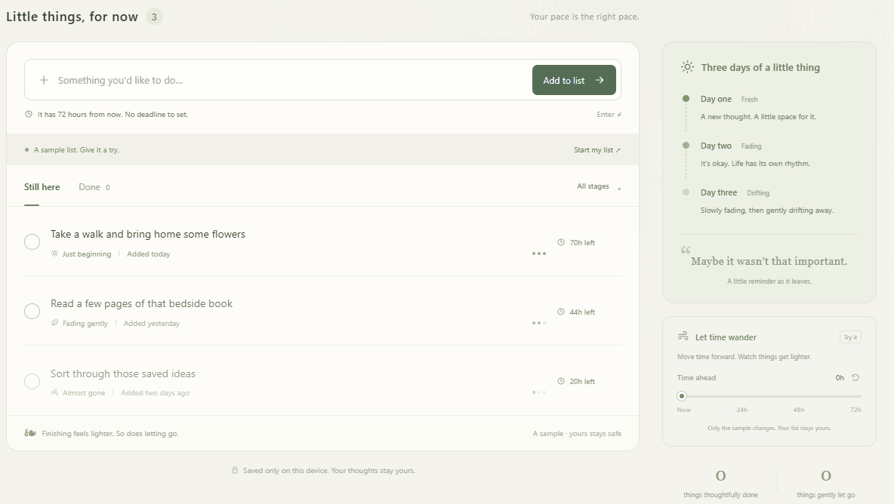

# Three Days

**A to-do list that lets go after 3 days. Six calming themes. Fully offline.**

Unfinished tasks gently fade and disappear after 72 hours, with a simple thought: **Maybe it wasn't that important.** Completed tasks stay in Done.

**[Download for Windows (x64)](https://github.com/yeze5421/sanri-todo/releases/latest/download/Three-Days-Windows-x64.exe)** · [All releases](https://github.com/yeze5421/sanri-todo/releases)

Portable desktop app. Six light and dark themes. No account. Your list stays on your device.



*A short preview of the themes and the optional time demo. Sample tasks are fictional and never become your personal history. Real tasks always get 72 hours.*

## Download and open

1. [Download Three Days for Windows (x64)](https://github.com/yeze5421/sanri-todo/releases/latest/download/Three-Days-Windows-x64.exe).
2. Save `Three-Days-Windows-x64.exe` anywhere you like and double-click it.
3. Add your first task to the empty list. Choose **Appearance** for a new look, or **Try 72 hours** for an optional sample demo.

The portable app includes its runtime: no installation, browser, local web server, Node.js installation, account, or internet connection is needed to use it. A SHA-256 checksum file is available alongside the download.

To update, close the app and replace the executable with the latest download. Your list stays in the local data folder described below.

The app runs in its own window. Closing the window quits the app; opening it again restores your list and clears tasks whose original 72 hours have passed. Launching it twice focuses the existing window.

## Use your list

- The entire interface is in English, including sample tasks, dates, notifications, and accessibility labels.
- Your first visit opens an empty list with zero history and counters.
- Select **Try 72 hours** to explore a separate, fictional sample list. Move the time slider to see tasks fade and disappear without changing your personal list.
- Select **Back to my list** or **Start my list** to leave the demo. Adding a task also returns to your personal list.
- Every task gets exactly **72 hours** from creation. Time keeps moving while the app is closed; expired tasks are cleared when you return.
- Completed tasks remain in **Done**. Expired tasks leave only a count, without retaining their titles.
- Completing a task or letting it go offers a brief undo. Undo keeps the original deadline.
- Press `Ctrl+K` to focus the task input.

## Find your kind of calm

Choose **Appearance** in the header to switch themes instantly. Your choice is saved on this device and restored when you reopen the app.

| Theme | Mood | Mode |
| --- | --- | --- |
| Sage | A quiet little garden, soft greens, and botanical details | Light |
| Linen | Warm paper, amber accents, and a subtle paper texture | Light |
| Rosewater | Blush tones, rounded cards, and a softer atmosphere | Light |
| Tide | Ocean blues, crisp type, and an airy background | Light |
| Midnight | Deep indigo, lavender accents, and a quiet star field | Dark |
| Graphite | Charcoal, clean typography, and a subtle grid | Dark |

Themes also style dialogs, inputs, task states, and notifications. Keyboard navigation and reduced-motion preferences are supported.

## Local data

Desktop data is stored under `%APPDATA%\Three Days`, separately from the executable. Moving or replacing the executable does not reset your list. Removing this data folder clears the desktop list.

To start over, choose **Appearance → Clear my data**, then confirm. This removes your tasks, completed records, counters, and theme preference from this app on this device. It cannot be undone.

Release packages contain only application files, never personal profiles, task history, or test data. New installations start empty. Updating an existing installation preserves its own saved list unless you explicitly clear it.

The desktop app uses its own local profile. Existing data in the earlier browser version remains in that browser and is not automatically copied or synced into the desktop app. The original storage key is retained within each profile for compatibility.

## Development and builds

Requires Node.js 22.14 or newer. Build dependencies are pinned in `package-lock.json`.

```sh
npm ci
npm start
```

Create the portable Windows x64 executable:

```sh
npm run build:win
```

The output is `dist/Three-Days-Windows-x64.exe`; `start.cmd` opens it after a build. `dist/win-unpacked/Three Days.exe` is also runnable, but must stay with the other files in that folder. Build output is ignored by Git. The build command never publishes releases.

For the optional browser preview, run `npm run web` and open <http://localhost:4173>. The desktop app does not use this server.

The desktop wrapper uses [Electron](https://www.electronjs.org/docs/latest/tutorial/security) with sandboxed local content, isolated contexts, and a fixed asset allowlist. Packaging uses [electron-builder's portable Windows target](https://www.electron.build/v26/docs/nsis/#portable).

## Checks

```sh
npm test
npm run check
npm run test:desktop
```

Tests cover the 72-hour boundary, offline expiration, completed records, undo deadlines, storage validation, immutable state transitions, safe text interpolation, and desktop asset/navigation boundaries.

The desktop smoke check launches hidden app windows with a disposable profile. It verifies all six themes, theme persistence, narrow-window layout, sample isolation, saved tasks, offline expiration, cancellation of data clearing, and a confirmed reset that stays empty after reopening. It never reads or changes your real desktop profile.

## License

Three Days is licensed under the [MIT License](LICENSE).
Copyright (c) 2026 yeze5421.

Third-party dependencies and the bundled Electron runtime retain their own licenses and notices.
